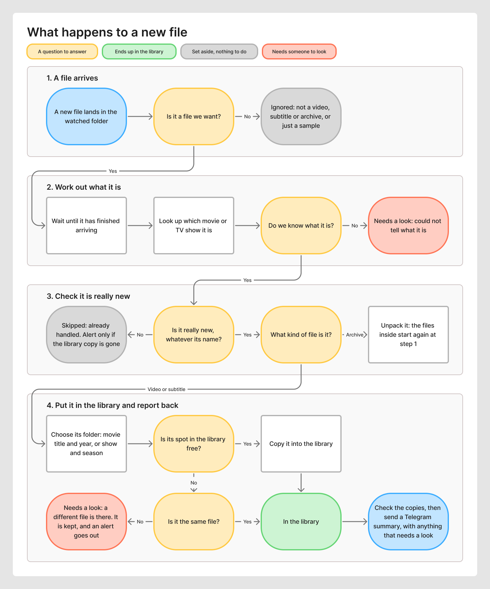

# Scene Media Organizer (SMO)

A Python-based file monitoring and media organization system that automatically processes video files and archives,
organizing them into structured directories based on media metadata.

### Request flow
The chart below shows a simplified, happy-path request flow.


## How does it work?
We have four major elements in this application:
1. File system monitor: Triggered whenever a file/folder is created.
2. Memory Queue: To temporarily hold the files that we receive in the events
3. Activity Tracker: Logs all the activity happening in the system, so it can be closely monitored.
4. MQTT Queue: To decouple the file processing from the notification system.

### File Processing
- Files created under `WATCH_FOLDER` are detected by a watchdog observer (`main.py`).
- When the service starts, it also queues every file already in `WATCH_FOLDER` that the work queue has never seen, so files that arrived while it was down are not missed.
- Each file event is enqueued in memory and normalized (`src/queue_worker.py`):
  - Directories are ignored.
  - Archives are detected, and only the main/first volume is considered (multipart volumes are ignored: we just need the main file to decompress it).
  - Files named like "sample" or executables are ignored.
  - Remaining items are persisted to the Postgres-backed work queue as `PENDING` via `WorkQueueManager`.
- The batch processor (`src/batch_processor.py`) continuously fetches the next batch and processes each item:
  - Wait until the file is stable (size unchanged for a short period).
  - Identify media via the [media identifier API](https://github.com/brenordv/media-identifier-api) (2.0 or newer). See "Media identifier answers" below.
  - If the item is an archive, it is decompressed in place (supports 7z/rar/zip/tar/gz/bz2/xz); then the item is marked `DONE`. The new file will be processed in the next batch automatically.
  - If it is a video file, the destination is resolved from metadata:
    - Movies → `MOVIES_BASE_FOLDER/<Title>--<Year>` (year optional)
    - TV → `SERIES_BASE_FOLDER/<Title>/SeasonXX` (season 0 holds specials)
  - The file is copied to the destination; on success the item is marked `DONE`, otherwise it will be retried once.
  - At the end of the batch, any straggling `WORKING` items are moved back to `PENDING`, so we can give it one more try, the batch is closed, and a verification step compares source/destination (size and SHA-256) for `DONE` items.
  - A completion payload (items, verification result and details) is published to MQTT for notifications.

### Notification System
- A background consumer (`src/notification_receiver.py`) subscribes to `MQTT_BASE_TOPIC` using `NotificationRepository` (MQTT).
- On batch-complete messages it:
  - Deserializes the payload and computes insights (totals, per-status counts, archives, destination set count, failures, unique filenames) and a summary.
  - Renders a concise, HTML-formatted report, including verification results (size/hash checks).
  - Splits long messages to respect Telegram limits and sends them via the Telegram Bot API using `send_telegram_message`.

## Requirements

### External dependencies
- PostgreSQL 13 or newer.
- [media identifier api](https://github.com/brenordv/media-identifier-api) 2.0 or newer.
- An MQTT broker.
- [Infisical](https://infisical.com/), holding this application's settings.
- A 7-Zip binary (`7zz`) for RAR extraction. The Docker image ships 7-Zip 26.06.

#### Local prerequisites
- [uv](https://docs.astral.sh/uv/) manages the dependencies and runs the app. It installs Python 3.14 (`.python-version`) when needed.
- A 7-Zip binary (`7zz`) on `PATH`, or `UNRAR_PATH` pointing at one, for archive extraction.

No C build toolchain or `libpq` is needed: `psycopg[binary]` bundles its own libpq and `uv` builds the environment straight from the lockfile.

## Configuration

Settings come from two places:

- **Infisical** holds the service addresses and credentials (table below). The app reads every one of them once at startup and exits with code 2, naming what is missing or invalid, when a required one is not set.
- **Command-line flags, the environment and a `.env` file** hold the rest, highest precedence first. The `.env` fallback never overrides a value already in the environment. A variable set to an empty string still counts as set, so inside a container prefer real environment values; leave a variable unset (rather than `""`) if you want `.env` to fill it.

`.env.example` lists every variable.

### Infisical bootstrap (environment or `.env`)

| Variable                                  | Purpose                                                                   |
|-------------------------------------------|---------------------------------------------------------------------------|
| `INFISICAL_HOST`                          | Infisical URL. `https://` is assumed when the scheme is missing.          |
| `INFISICAL_ENV`                           | Infisical environment to read (default `dev`).                            |
| `INFISICAL_MEDIA_ORGANIZER_CLIENT_ID`     | Universal Auth client id of this app's machine identity.                  |
| `INFISICAL_MEDIA_ORGANIZER_CLIENT_SECRET` | Universal Auth client secret.                                             |
| `INFISICAL_MEDIA_ORGANIZER_PROJECT_ID`    | Infisical project holding the secrets below.                              |

Give the machine identity read access to the project. A plain `http://` host works but logs a warning, since the client secret then crosses the network unencrypted.

### Secrets in Infisical

All are read from the root path (`/`) of `INFISICAL_ENV`. Surrounding whitespace is ignored.

| Secret                                        | Required | Purpose                                                                                          |
|-----------------------------------------------|----------|--------------------------------------------------------------------------------------------------|
| `MEDIA_ORGANIZER_POSTGRES_CONNECTION_STRING`  | yes      | `postgresql://media_organizer:<password>@<host>:5432/smo_watchdog`, or libpq `key=value` pairs. Percent-encode special characters in a URI password. |
| `MEDIA_ORGANIZER_MEDIA_IDENTIFIER_URL`        | yes      | Base URL of the media identifier, e.g. `http://media-identifier:10147` (the app adds `/api/guess`). Plain http is fine for an internal host. |
| `MEDIA_ORGANIZER_MQTT_HOST`                   | yes      | MQTT broker host.                                                                                |
| `MEDIA_ORGANIZER_MQTT_PORT`                   | no       | MQTT broker port (default `1883`).                                                               |
| `MEDIA_ORGANIZER_MQTT_USERNAME`               | no       | MQTT login; omit when the broker needs no authentication.                                        |
| `MEDIA_ORGANIZER_MQTT_PASSWORD`               | no       | MQTT password.                                                                                   |
| `MEDIA_ORGANIZER_TELEGRAM_BOT_TOKEN`          | no       | Telegram bot token. Without it (or the chat id) batch reports are not sent, and startup logs a warning. |
| `MEDIA_ORGANIZER_TELEGRAM_CHAT_ID`            | no       | Telegram chat that receives the reports.                                                         |

### Command-line flags

Each flag sets the matching environment variable:

| Flag                   | Variable                      | Purpose                                          |
|------------------------|-------------------------------|--------------------------------------------------|
| `--watch-folder`       | `WATCH_FOLDER`                | Directory to monitor for new files (required)    |
| `--movies-base-folder` | `MOVIES_BASE_FOLDER`          | Base directory for movies (required)             |
| `--series-base-folder` | `SERIES_BASE_FOLDER`          | Base directory for TV series (required)          |
| `--mqtt-base-topic`    | `MQTT_BASE_TOPIC`             | Base topic for MQTT messages (default `notifications`) |
| `--mqtt-client-id`     | `MQTT_CLIENT_ID`              | MQTT client id                                   |
| `--otel-endpoint`      | `OTEL_EXPORTER_OTLP_ENDPOINT` | OTLP exporter endpoint (required)                |
| `--unrar-path`         | `UNRAR_PATH`                  | Archive-extraction binary (defaults to `7zz`)    |

`--env-file PATH` loads fallback values from `PATH` instead of `./.env`. `on_demand.py` also accepts `-y`/`--yes` to skip its confirmation prompt. Run either entry point with `--help` to list every flag.

The 2.x flags for Postgres, the API URL, the MQTT host, port and login, and Telegram no longer exist; those values live in Infisical. Passing one stops the run with exit code 2 and names the flag without echoing its value.

### Tuning variables (no flag)

- `ACTIVITY_DB_LOG_LEVEL` - the lowest level written to the `activity_tracker` table: `DEBUG` (default), `INFO`, `WARNING`, `ERROR` or `CRITICAL`. OTEL logging is not affected. `DEBUG` writes a row for every debug line; `INFO` is a better fit for normal running.
- `TELEGRAM_API_BASE` - Telegram Bot API base URL (default `https://api.telegram.org`); must be https, because the bot token travels in the request path.
- `TELEGRAM_PARSE_MODE` - Telegram parse mode. Defaults to `HTML`.
- `TELEGRAM_DISABLE_WEB_PREVIEW` - Defaults to `true` when unset (the image sets `false`).
- `TELEGRAM_DISABLE_NOTIFICATION` - Defaults to `false`.
- `WATCHDOG_CHANGE_DEST_OWNERSHIP_ON_COPY` - Defaults to `false`. Copies get the source file's owner; only for a container run as root (see "Container").
- `WATCHDOG_COPY_USING_RSYNC` - Defaults to `false` (copies with Python).
- `MQTT_LOG_LEVEL`, `MQTT_TLS_CA_CERT`, `MQTT_KEEPALIVE_SECONDS` - MQTT client tuning.

## Database

The application creates and updates its tables itself: at startup, before anything else touches the database, it applies the numbered SQL files in `migrations/` that have not run yet and records each in a `schema_migrations` table. A fresh, empty database is set up on the first start. When a service and an `on_demand.py` run start together, one waits for the other (a PostgreSQL advisory lock), so each file runs once. Migrations connect directly; when a connection pooler sits in front of PostgreSQL it must run in session mode, because the lock lives in the database session.

A migration that fails is rolled back and the process exits with code 1 and a message naming the file.

### A dedicated role for the application

Run the scripts in `sql/` with `psql` as a superuser, from a terminal: psql prompts for the role's password (`\password`), so it never lands in a file, the shell history or the server log. Both scripts stop at the first error and can be run again.

When PostgreSQL runs in Docker, copy the script into the container first, then run psql there with a terminal attached:

```bash
docker cp sql/grant_existing_database.sql <postgres-container>:/tmp/
docker exec -it <postgres-container> psql -v ON_ERROR_STOP=1 -U postgres -d postgres -f /tmp/grant_existing_database.sql
```

**Fresh install** - creates the role `media_organizer` and the database `smo_watchdog` it owns:

```bash
psql -v ON_ERROR_STOP=1 -h <host> -U postgres -d postgres -f sql/create_app_role.sql
```

**Existing 2.x install** - creates the role and gives it the existing database and tables. Stop the 2.x service first, and run this before the first 3.0.0 start: the migrations alter the tables, which only their owner can do.

```bash
psql -v ON_ERROR_STOP=1 -h <host> -U postgres -d postgres -f sql/grant_existing_database.sql
```

Both take `-v app_role=<name>` and `-v app_db=<name>` to use other names, and `-v set_password=1` to set a new password for an existing role (this is also the fix when an earlier run was interrupted at the password prompt). `grant_existing_database.sql` also takes `-v revoke_public=1` (only the role and superusers may connect; leave it off if other logins read this database) and `-v pg14_public_schema=1` for clusters upgraded from PostgreSQL 14 or older, where every role may still create objects in `public`.

The role owns its database, which lets it create the tables the migrations need without superuser rights, and also lets it rename or drop that database. Then set `MEDIA_ORGANIZER_POSTGRES_CONNECTION_STRING` in Infisical to connect as the role.

## Media identifier answers

| Answer                         | What happens to the file                                                                 |
|--------------------------------|------------------------------------------------------------------------------------------|
| 200 with a record              | Filed (or decompressed, for an archive).                                                  |
| 204, 400, 404, 422             | Final: `FAILED_ID`. 204 means it is not a movie or episode, or nothing identified it.     |
| 502, 503, 504, unreachable     | Retried in the same call (up to 3 times per request, backing off 2 s then 4 s; network errors repeat that up to 3 times), then left `PENDING` for a later batch without using up an attempt. The batch logs one warning with the count. |
| 500 or anything else           | Counts as a failed attempt; after 5 the item becomes `FAILED_MAX_ATTEMPTS`.               |

On TV records, identifier 2.0 puts the episode's TMDB id in `tmdb_id` and the series' in `tmdb_series_id`. Filing uses the title and season, so this changes nothing here.

## Operational behavior

Run the container with a restart policy (`unless-stopped` or `on-failure`). The three worker threads restart themselves with capped exponential backoff when they crash, but if the file-system observer dies the process exits on purpose so the restart policy brings the whole service back.

### Health check

Every 60 seconds the service runs `SELECT 1` on the database, checks its MQTT connection, and writes the result to a heartbeat file in the temp folder (`/tmp/scene-media-organizer-heartbeat.json` in the container). `healthcheck.py`, the image's `HEALTHCHECK`, reports unhealthy when `WATCH_FOLDER` is missing, the heartbeat is older than 3 minutes, or either check failed. The service logs a dependency only when its state changes.

### Item statuses

Terminal failure statuses an item can land on:

- `FAILED_ID` - the identifier returned no usable metadata.
- `FAILED_MISSING` - the source file vanished before it could be processed.
- `FAILED_MAX_ATTEMPTS` - the item failed 5 processing attempts. Transient conditions (identifier unavailable, file still being written) refund the attempt, so only genuine repeated failures reach the cap.
- `FAILED_PERMISSIONS` - a copy hit a permission problem: an unreadable source, an unwritable library folder, or an ownership change without root. It is not retried, and one Telegram alert names the file, the item id and the error. With the ownership option the file may already be in the library.

All of them appear in the batch's Telegram report. To re-queue an item, set `status = 'PENDING', attempts = 0` on its `work_queue` row:

```sql
UPDATE work_queue SET status = 'PENDING', attempts = 0 WHERE id = '<item id>';
```

A re-queued item that fails on permissions again sends a new alert. Archives that cannot be read or extracted send no alert: they use up their attempts and end as `FAILED_MAX_ATTEMPTS`.

One exception to the report: `on_demand.py` sweeps orphaned `WORKING` items (left by an earlier crash) back to pending before it builds a batch, and any it caps there are logged to the console only, not to Telegram. The in-batch cap during normal processing does reach the Telegram report.

### Resumable maintenance runs

Interrupting `on_demand.py` (Ctrl+C, a crash, or a kill) leaves the batch open. Re-running the same command resumes that batch: it redoes the file that was mid-processing, skips items already completed, and sends one final report covering the whole batch, including the items finished before the interruption. Pressing Ctrl+C at the confirmation prompt, before any work starts, aborts without touching the database.

A few consequences worth knowing:

- Interrupted pickups do not consume the attempt cap: an item that was only picked up and then interrupted has its attempt refunded on resume. For scheduled use this is a trade-off. A non-interactive run (`--yes`, for example from cron) that keeps crashing on the same poison item keeps refunding it and never reaches `FAILED_MAX_ATTEMPTS`. The watchdog service still enforces the strict cap; the `on_demand` path deliberately does not.
- Resuming a batch left behind by a crashed *service* container works, but that batch's already-completed items were recorded with in-container paths (`/watch`, `/movies`, `/series`). If those paths do not resolve on the machine running `on_demand.py`, the final report flags them as verification failures even though the copies are fine.
- The "stop the container service first" advice above still applies: resuming a batch the running service currently owns can double-process items.

### Re-checking media filed under identifier 1.x

Identifier 1.x sometimes returned wrong answers (a TV episode as a movie, the wrong episode's data). `on_demand.py recheck` sends the name of every filed item to the identifier again and lists the files it would now place in a different folder, the ones it no longer recognizes, and the ones whose identification failed. It only reports: nothing is moved and the database is not changed. It needs no confirmation and exits 1 when the identifier became unavailable partway (run it again later).

## Container

The image runs as user `1000:1000`. Run it as the user who should own your library, and every file and folder it creates belongs to that user, whoever owns the source:

```bash
docker run --user "$(id -u):$(id -g)" ...
```

```yaml
user: "1000:1000"
cap_drop: [ALL]
security_opt: ["no-new-privileges:true"]
```

That user needs:

- Read access to the source files. A file another user owns is fine if it is readable, for example mode `644`, or `640` with the user in its group (`--group-add` or `group_add`). A mode like `600` ends as `FAILED_PERMISSIONS`. So does a library folder the user cannot write to. A file inside a folder the user cannot enter looks like it is gone and ends as `FAILED_MISSING`.
- Read and write access to the watch folder, because archives are extracted next to themselves.
- Write access to the movie and series libraries.

Have your downloader write files this user can read, by running as the same user or in its group with a umask like `002` or `022`.

`WATCHDOG_CHANGE_DEST_OWNERSHIP_ON_COPY` needs root, because only root can give a file to another user. To use it, run with `--user 0:0` and `cap_add: [CHOWN, DAC_OVERRIDE, FOWNER]`. Without root, the service warns at startup.

A non-root user limits what a compromised archive extractor can do to the container, not to your media: the extractor runs as the same user, so it can still write the library and the watch folder.

Archives are extracted where they are found. A crafted archive can expand far beyond its size (a decompression bomb), so keep the watch folder on a volume where filling the disk is survivable.

## Usage

1. Set up the database role (see "Database") and the Infisical secrets (see "Configuration").
2. Provide the bootstrap and the folders as CLI flags, environment variables, or a `.env` file.
3. Sync the environment and start the watchdog:
   ```bash
   uv sync
   uv run python main.py
   ```
`uv run` executes inside the project environment, so there is no virtual environment to activate. The app then monitors the watch folder and processes new media files and archives as they arrive.

For maintenance runs:
```bash
uv run python on_demand.py batch      # process everything already pending
uv run python on_demand.py missing    # queue on-disk files not yet tracked, then process
uv run python on_demand.py recheck    # report filed media the identifier would now file elsewhere
```
Add `--yes` to skip the confirmation prompt in non-interactive runs (`recheck` never asks).

A batch run with the folders given as flags; the bootstrap comes from the environment or `.env`:

```bash
uv run python on_demand.py batch \
  --watch-folder /data/watch \
  --movies-base-folder /data/movies \
  --series-base-folder /data/series \
  --otel-endpoint http://otel-collector:4317 \
  --yes
```

### Convenience scripts
- Linux: `start.sh`
- Windows: `start.bat`

Each checks that `uv` is installed, runs `uv sync`, and starts `main.py`.
